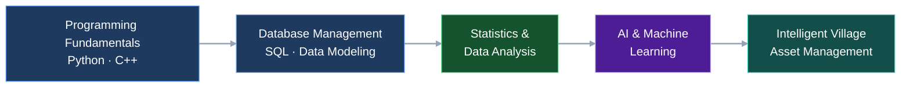

<!-- =========================================================
     # KUKUH RIYANTO | PROFESSIONAL GITHUB PROFILE
     ========================================================= -->

<h1 align="center">Kukuh Riyanto</h1>

<h3 align="center">
  Policy Analyst · Asset Management & Valuation · AI & Data Science
</h3>

  
  
  

  

  <em>
    Evidence-based decisions. Intelligent technology. Meaningful impact.
  </em>

---

## 👨‍💻 About Me

I am a policy analyst with interests in **data-driven decision-making, asset management, valuation, artificial intelligence, and rural economic development**.

Coming from a small village in Indonesia, I am motivated to explore how knowledge, data, and technology can help solve practical challenges and support more effective public policy.

I am continuously developing my technical capabilities while connecting analytical thinking with real-world problems.

- 🔭 **Current focus:** Artificial intelligence, programming, databases, and analytical problem-solving.
- 📊 **Analytical interests:** Statistics, data analysis, asset valuation, and predictive analytics.
- 🏡 **Research direction:** Intelligent village asset management and rural economic development.
- 🧠 **Technical exploration:** Search algorithms, heuristic functions, rule-based systems, and machine learning.
- 🎯 **Long-term vision:** Develop practical, data-driven solutions that support better decisions and sustainable development.
- 🤝 **Open to:** Research collaboration, knowledge sharing, and opportunities to learn from technology professionals.

> "Turning knowledge into skills, data into insights, and ideas into impact."

---

## 🧭 Professional Focus

<table>
  <tr>
    <td width="50%" valign="top">
      <h3 align="center">📊 Policy & Analytics</h3>
      

        Evidence-based policymaking 
        Statistical analysis 
        Asset management & valuation 
        Decision support
      

    </td>
    <td width="50%" valign="top">
      <h3 align="center">🤖 Technology & AI</h3>
      

        Python & C++ programming 
        Artificial intelligence 
        Database management 
        Predictive analytics
      

    </td>
  </tr>
  <tr>
    <td width="50%" valign="top">
      <h3 align="center">🏡 Rural Development</h3>
      

        Village asset optimization 
        Rural economic development 
        Investment opportunity analysis 
        Sustainable development
      

    </td>
    <td width="50%" valign="top">
      <h3 align="center">📈 Continuous Learning</h3>
      

        Algorithms & problem-solving 
        Statistics & machine learning 
        Data visualization 
        Practical project development
      

    </td>
  </tr>
</table>

---

## 🛠️ Technical Skills

  

  
  
  
  

| Domain | Technologies & Areas |
|---|---|
| Programming | Python, C++ |
| Databases | MySQL, Oracle SQL*Plus |
| AI & Algorithms | BFS, DFS, heuristic search, game-tree reasoning, rule-based systems |
| Data & Statistics | Statistical analysis, data interpretation, predictive analytics — developing |
| Asset Management | Asset identification, condition assessment, valuation, portfolio development |
| Policy & Research | Policy analysis, descriptive research, evidence-based decision-making |
| Development Tools | GitHub, Visual Studio Code |

*Skills listed as areas of exploration represent ongoing learning rather than claims of advanced proficiency.*

---

## 🚀 Featured Projects

Explore my current programming work and future research direction.

<strong>🤖 AI-Pratical — Artificial Intelligence & Search Algorithms</strong>

 

A practical collection of AI exercises focused on intelligent problem-solving, state-space search, game strategies, and rule-based reasoning.

**Topics explored**

| # | Project | Core Concept |
|---|---|---|
| 01 | Single-Player Game | AI decision-making |
| 02 | Heuristic-Based Single-Player Game | Heuristic evaluation |
| 03 | Tic-Tac-Toe with Heuristics | Game-tree search |
| 04 | N-Queens Problem | Backtracking & constraints |
| 05 | Travelling Salesman Problem | Combinatorial optimization |
| 06 | Rule-Based System | Knowledge representation |
| 07 | Medical Diagnosis Expert System | Rules & inference |
| 08 | Water Jug with BFS | Breadth-first search |
| 09 | Water Jug with DFS | Depth-first search |
| 10 | 8-Puzzle with BFS | State-space exploration |
| 11 | 8-Puzzle with DFS | Search strategies |

  

<strong>🐍 myProject — Python Programming & Problem-Solving</strong>

 

A Python programming workspace for strengthening programming fundamentals, logical reasoning, and practical coding skills.

**Focus areas**

- Python fundamentals and programming practice
- Algorithmic thinking and problem-solving
- Practical coding exercises
- Learning through experimentation and iteration

  

<strong>🏡 Research Roadmap — Intelligent Village Asset Management</strong>

 

A proposed research direction exploring how data analytics and artificial intelligence could support village asset management and rural economic development.

**Proposed research components**

1. Asset inventory, database, and portfolio development.
2. Asset condition assessment and valuation.
3. Asset potential analysis and predictive modeling.
4. Investment opportunity identification.
5. Strategy prioritization and decision support.
6. Exploration of Graph Neural Networks (GNNs) for relational asset analysis.

**Potential technology stack**

`Python` · `SQL` · `Statistics` · `Machine Learning` · `Graph Neural Networks` · `Data Visualization`

**Research objective:** Explore ways to transform village asset information into actionable insights for better asset utilization and investment decisions.

*Status: Proposed research direction; implementation and results are not claimed.*

## 🧭 My Learning Roadmap

  <em>Learn → Practice → Analyze → Innovate → Create Impact</em>

### My Learning Principles

- 🌱 Learn consistently and strengthen foundational knowledge.
- 💻 Apply concepts through hands-on programming projects.
- 📈 Develop statistical and analytical thinking.
- 🔍 Test ideas, evaluate results, and learn from mistakes.
- 🤝 Share knowledge and collaborate with others.
- 🌍 Connect technical solutions with real-world development needs.

---

## 📊 GitHub Activity

  
  

  

  

---

## 📬 Let's Connect

I welcome opportunities to exchange ideas, discuss research, and learn about the practical applications of data science, AI, asset management, and public policy.

  
  
  

  <strong>Thanks for visiting my profile!</strong>
   
  <em>Keep Learning · Keep Building · Create Impact</em>

